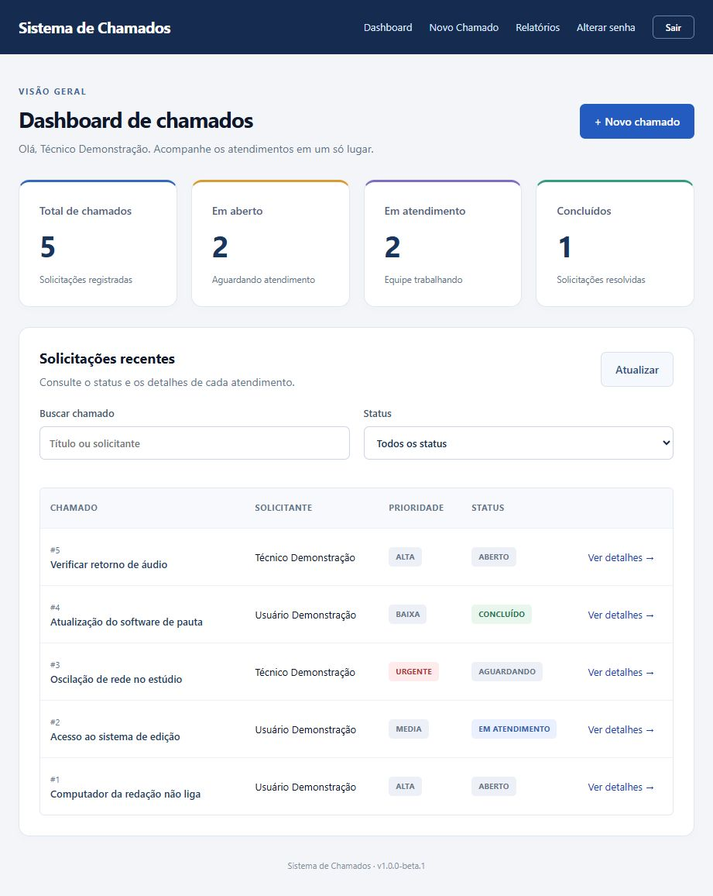

# Sistema de Chamados

Aplicação de controle de chamados técnicos, inspirada no fluxo de um helpdesk corporativo. Permite cadastrar usuários, entrar no sistema, abrir solicitações e acompanhar o atendimento até a conclusão.

**Versão:** `1.0.0-beta.1` · **Status:** validada localmente; deploy público pendente.

## Links da entrega

- **Repositório configurado neste projeto:** [FelipeSeiji/Sistema-de-Chamados](https://github.com/FelipeSeiji/Sistema-de-Chamados).
- **Aplicação publicada:** pendente. A publicação no Railway exige uma conta com plano ativo. Ainda não existe uma URL pública desta versão.
- **Código da atividade:** o ZIP deve ser gerado com `scripts/package-source.ps1`, que inclui os arquivos de código e o print deste README.

Antes de entregar, publique esta versão em um repositório individual da sua conta e ajuste o link acima se necessário. As alterações preparadas localmente precisam ser enviadas ao GitHub para que o avaliador tenha acesso a elas.

## Dashboard

Print real da aplicação em execução local, autenticada como técnico, usando dados fictícios. A tela é implementada em `sistema_chamado/frontend/src/app/pages/dashboard/`; a imagem também acompanha o ZIP do código.



## Versionamento semântico

O projeto utiliza o formato `MAJOR.MINOR.PATCH[-PRÉ-LANÇAMENTO]`:

| Parte | Quando muda | Exemplo |
| --- | --- | --- |
| MAJOR | Mudanças incompatíveis com contratos ou fluxos anteriores | `1.0.0` → `2.0.0` |
| MINOR | Novas funcionalidades compatíveis | `1.0.0` → `1.1.0` |
| PATCH | Correções compatíveis, sem novas funcionalidades | `1.0.0` → `1.0.1` |
| Pré-lançamento | Identifica uma versão em validação antes da versão estável | `1.0.0-beta.1` → `1.0.0-beta.2` |

Em **`1.0.0-beta.1`**, `1` identifica a primeira linha principal do sistema, os dois zeros indicam sua versão inicial e `beta.1` identifica a primeira versão de avaliação. O sufixo permanece porque o deploy público ainda não foi validado. Backend (`pom.xml`), frontend (`package.json` e lockfile), dashboard e endpoint de saúde usam a mesma versão.

As próximas versões devem seguir esse formato e receber uma tag Git correspondente, por exemplo `v1.0.0-beta.1`, após o commit de entrega.

## Funcionalidades e perfis

- Cadastro público de contas comuns e login por e-mail e senha.
- Sessão por cookie HttpOnly, restauração após atualizar a página e logout no servidor.
- Dashboard com indicadores, busca por título/solicitante e filtro por status.
- Abertura, consulta, edição, cancelamento e reabertura de chamados.
- Início do atendimento e conclusão com solução técnica por técnicos e administradores.
- Relatório de distribuição por status para a equipe técnica.
- Listagem, exclusão de usuários sem chamados e redefinição de senha pelo administrador.
- Alteração da própria senha e armazenamento de senhas com BCrypt.

| Perfil | Acesso |
| --- | --- |
| Usuário | Consulta e gerencia os próprios chamados |
| Técnico | Consulta os chamados e realiza atendimentos e conclusões |
| Administrador | Acesso técnico e administração de usuários |

O cadastro público sempre cria o perfil `USUARIO`, mesmo se outro perfil for enviado à API. As restrições também são aplicadas pelo backend.

## Acesso de demonstração

Para criar os dados fictícios automaticamente, inicie com `DEMO_ENABLED=true` ou `--app.demo.enabled=true`. O Docker Compose já habilita esse modo.

| Perfil | E-mail | Senha |
| --- | --- | --- |
| Técnico | `tecnico@chamados.demo` | `Demo@12345` |
| Usuário | `usuario@chamados.demo` | `Demo@12345` |
| Administrador | `admin@chamados.demo` | `Demo@12345` |

Qualquer pessoa também pode usar **Criar conta**, cadastrar um usuário e fazer login. Os dados de demonstração são inseridos quando não existem e não são apagados nem recriados a cada reinicialização de um banco persistente.

## Tecnologias

- Backend: Java 21+, Spring Boot 3.5.16, Spring Security, Spring Data JPA, Bean Validation, MapStruct e Lombok.
- Frontend: Angular 22, TypeScript e RxJS.
- Banco: H2 em memória para execução rápida; PostgreSQL 16 no Docker Compose e no deploy planejado.
- Distribuição: um único JAR/Docker contendo o frontend e a API, na mesma origem.

## Executar com Docker

Requer Docker Engine/Docker Desktop em execução e Docker Compose.

```bash
cd sistema_chamado
docker compose up --build
```

Acesse [http://localhost:8080](http://localhost:8080). O PostgreSQL usa um volume persistente e não expõe sua porta ao computador. Para definir a senha local do banco, copie `.env.example` para `.env` e ajuste `DB_PASSWORD` antes da primeira inicialização.

Para parar sem apagar os dados:

```bash
docker compose down
```

## Executar sem Docker no Windows

Requer JDK 21+ (com `JAVA_HOME` correto), Node.js 24 e npm. O Maven Wrapper acompanha o projeto.

Na raiz do repositório:

```powershell
powershell -ExecutionPolicy Bypass -File .\scripts\build.ps1
java -jar .\sistema_chamado\target\sistema_chamado-1.0.0-beta.1.jar --app.demo.enabled=true
```

Acesse [http://localhost:8080](http://localhost:8080). Essa opção utiliza H2 em memória: os dados são perdidos ao encerrar o processo. Para usar outra porta, acrescente `--server.port=8081`.

Durante o desenvolvimento, também é possível executar `mvnw.cmd spring-boot:run` em `sistema_chamado` e `npm start` em `sistema_chamado/frontend`. Nesse caso, o frontend abre em `http://localhost:4200` e encaminha `/api` para a porta 8080.

## Validação

```powershell
cd sistema_chamado
.\mvnw.cmd clean verify -B
cd frontend
npm ci
npm test -- --watch=false
npm run build
```

Foram aprovados **4 testes de backend** e **2 testes de frontend**, além do build de produção e do empacotamento do JAR. Os testes cobrem o ciclo do chamado, cadastro sem elevação de privilégio, login, troca de senha, sessão, logout, CSRF, acesso aos próprios chamados e atualização assíncrona do dashboard. O fluxo de login e a interface também foram conferidos no navegador local.

O arquivo `.github/workflows/verify.yml` executa a validação ao enviar código ao GitHub. O Docker Compose teve sua configuração validada; a imagem Docker não foi construída nesta máquina porque o daemon Docker está desligado.

## Deploy em um projeto novo no Railway

Siga [o guia de publicação](docs/deploy-railway.md). A configuração inclui Dockerfile com build do frontend e backend, suporte à porta `PORT`, endpoint `/api/health` e conexão com PostgreSQL por variáveis de ambiente.

O deploy permanece pendente por decisão do responsável. Nenhuma aplicação existente foi alterada.

## Limites desta versão

- A recuperação de senha por e-mail não está implementada; a tela orienta procurar o administrador.
- Os dados e contas de demonstração são públicos e fictícios.
- A versão ainda não foi validada em um ambiente público nem contra um PostgreSQL em execução nesta sessão.
- O ZIP deve ser atualizado caso o código ou o print sejam alterados.

## Conferência antes da entrega

- [ ] Enviar esta versão para o repositório individual e conferir a imagem no README do GitHub.
- [ ] Criar a tag da versão correspondente ao commit enviado.
- [ ] Publicar em um projeto novo no Railway e preencher a URL pública neste README.
- [ ] Testar login em janela anônima com as credenciais documentadas e com uma conta recém-cadastrada.
- [ ] Gerar o ZIP com `scripts/package-source.ps1` e entregar a mesma versão do repositório.
